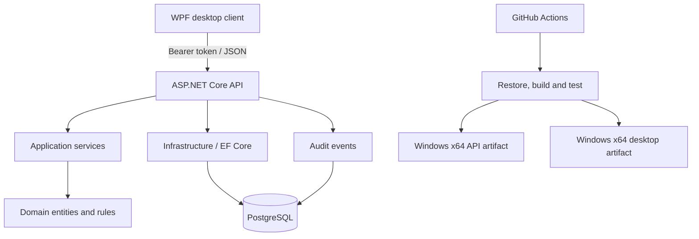
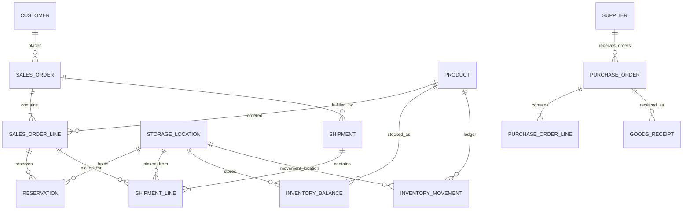

# IWMS architecture

## Request flow

## Main inventory relationships

## Fulfillment rules

- Reservations reduce available stock without reducing on-hand stock.
- Pick lists are built from active reservations and retain the source sales-order line and storage location.
- Dispatch releases the corresponding reservation and posts a dispatch inventory movement in the same database transaction.
- Shipment and sales-order status changes are audited.
- Order cancellation releases active reservations and cancels undispatched shipments. Orders with dispatched quantities cannot be cancelled through the ordinary cancellation route.
- Inventory adjustments and dispatches must be represented in the inventory movement ledger; do not edit on-hand totals directly in application code.

## Build artifacts

GitHub Actions runs on pushes to `master` and `main`, and on pull requests targeting those branches. After restore/build/test passes, separate Windows x64 artifacts are published for the API and WPF desktop client. The API requires a configured PostgreSQL database and JWT settings at runtime.
